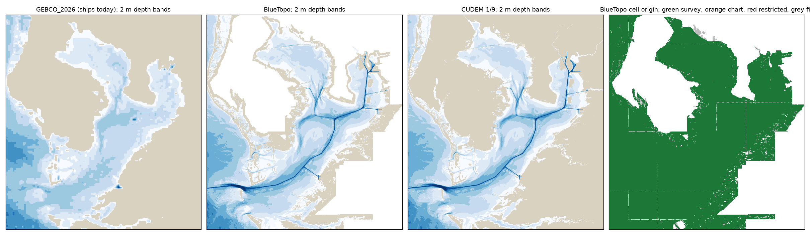

# Coastal bathymetry spike: BlueTopo against CUDEM, 2026-11-25

A tester's Tampa Bay model showed the bay as one flat depth step. Open water there
uses the global GEBCO_2026 grid (about 460 m). This spike measures two NOAA sources
that could sit above GEBCO on US coasts, and recommends one.

- **BlueTopo:** NOAA Office of Coast Survey, National Bathymetric Source. The same
  product family as the `noaa-nbs-*` lake archives.
- **CUDEM:** NOAA NCEI Continuously Updated Digital Elevation Model, 1/9 arc-second
  topography and bathymetry tiles. The 1/3 arc-second set is offshore only and
  covered 0.04% of the Tampa crop, so it is not considered further.

Measurements: [data/coastal-bathymetry-spike-2026-11-25.json](data/coastal-bathymetry-spike-2026-11-25.json).
Scripts: [data/coastal-bathymetry-spike-scripts/](data/coastal-bathymetry-spike-scripts/)
(`coverage.py`, `probe.py`, `compare.py`, `footprint.py`; run with the
`scripts/data-build/requirements.txt` environment plus matplotlib).

## Recommendation

1. **Use BlueTopo as the US coastal source, above GEBCO.** It covers more coast, its
   files state CC0, every cell names its survey, and the repository already has the
   scheme, pinning and attribute-table code for it.
2. **Use CUDEM 1/9 only where BlueTopo has nothing:** Washington and Oregon today.
3. **Build the independent depth interval first, or with it.** At Tampa a finer
   source adds the ship channels but not more depth sheets. The sheets are missing
   because depth uses the land step (36 m there), not because GEBCO is wrong.
   Built since as **Fit sea depth**; see [ocean-bathymetry.md](../ocean-bathymetry.md).

## What each source is

| | BlueTopo | CUDEM 1/9 |
| --- | --- | --- |
| Cell | 4 m (91% of tiles), 8 m, 16 m, a few 2 m | 1/9 arc-second, about 3.4 m |
| Content | Water, plus topobathy lidar that reaches ashore | Seamless land and water |
| CRS, datum | NAD83 UTM, NAVD88 | NAD83 geographic, NAVD88 (Puerto Rico: PRVD02) |
| Layers | Elevation, uncertainty, contributor index with attribute table | Elevation only |
| Tiles | 8,689 GeoTIFFs, 96.8 GB | 930 GeoTIFFs, 176 GB |
| Vintage | Every tile redelivered since 2026-08-13; 627 in the last 30 days | Tile years 2014–2025; half are 2019–2021 |
| Licence | Public domain; `TIFFTAG_COPYRIGHT` is CC0 1.0. Per-source licences in the attribute table | "Not subject to copyright protection within the United States"; no licence named |
| Access | Public S3, dated tile-scheme GeoPackage with SHA-256 per tile | Public S3, tile-index shapefile, no checksums |

Both carry cloud-optimized overviews, so a build can read them remotely at the
resolution it needs.

## Coverage

Tiles by region, from the tile scheme of 2026-11-24 and the CUDEM tile index:

| Region | BlueTopo | CUDEM 1/9 |
| --- | --- | --- |
| Gulf | 1,430 | 347 |
| Atlantic, Florida to North Carolina | 1,569 | 172 |
| Atlantic, Virginia to Maine | 1,838 | 235 |
| California | 1,332 | 40 |
| Oregon, Washington | 0 | 99 |
| Alaska | 2,209 | 16 |
| Puerto Rico, US Virgin Islands | 226 | separate datasets |
| Hawaii, Pacific territories | 0 | separate datasets |
| Great Lakes | 0 | 0 |

At the thirteen crops tried, BlueTopo was missing at Puget Sound, Honolulu and
Anchorage (the Anchorage crop only; Alaska has 2,209 tiles elsewhere). CUDEM 1/9 was
missing at San Diego, San Juan, Honolulu and Anchorage. NOAA says the Gulf, Atlantic
and US Caribbean are complete and that new regions arrive about every six months.

## Measurements

Each source was resampled to one 1 arc-second grid (about 30 m) per crop. Water is
every cell CUDEM puts below its datum, or BlueTopo where CUDEM is absent.

| Crop | BlueTopo covers water | BlueTopo fill cells | BlueTopo − CUDEM, median / median abs | GEBCO − CUDEM, median abs / p95 | Water GEBCO has at or above 0 m |
| --- | --- | --- | --- | --- | --- |
| Tampa Bay | 99.1% | 0.8% | −0.01 / 0.18 m | 0.90 / 4.2 m | 7.1% |
| Charleston | 99.1% | 5.9% | 0.00 / 0.07 m | 1.57 / 5.8 m | 18.0% |
| Outer Banks | 100% | 1.6% | −0.24 / 0.36 m | 0.68 / 7.9 m | 1.7% |
| Galveston | 98.5% | 2.1% | 0.06 / 0.17 m | 1.22 / 3.4 m | 9.8% |
| Miami | 99.8% | 6.1% | −0.01 / 0.19 m | 1.71 / 24.4 m | 4.1% |
| San Francisco Bay | 99.9% | 1.2% | 0.04 / 0.09 m | 1.10 / 7.8 m | 6.8% |
| Chesapeake (Annapolis) | 100% | 2.2% | −0.18 / 0.25 m | 1.57 / 7.8 m | 13.5% |
| Boston | 99.1% | 3.5% | −0.05 / 0.17 m | 3.07 / 10.3 m | 15.6% |
| Puget Sound | none | | | 8.07 / 31.0 m | 3.2% |
| San Diego | 100% | 5.6% | no CUDEM | (against BlueTopo) 3.07 / 7.2 m | 8.8% |
| San Juan | 100% | 15.4% | no CUDEM | (against BlueTopo) 5.49 / 35.4 m | 1.2% |

- **The two NOAA sources agree.** Median difference is under 0.25 m everywhere and
  the median absolute difference under 0.4 m. Either would give the same model.
- **BlueTopo is nearly all measured.** 84–98% of water cells come from an open
  survey. No cell at any crop came from a chart or a restricted source.
  Interpolated fill is 1–15% and is the weakest part: its median absolute difference
  from CUDEM is 0.2–1.8 m.
- **BlueTopo leaves small holes.** 0–1.5% of water has no value, mostly marsh and
  narrow creeks. GEBCO or the base terrain would keep those cells.
- **BlueTopo reaches ashore.** It holds values on 10–57% of the land cells in these
  crops, from topobathy lidar. It puts 0.2% (Tampa) to 10.7% (Boston) of the cells
  CUDEM has above 1 m below datum. The existing ocean rule replaces a cell only where
  the base terrain is also at or below sea level, which should keep it off the land,
  but that was not tested here.
- **GEBCO is coarse, not badly wrong.** Its typical error is 1–3 m in bays and 3–8 m
  on steeper coasts. It also puts 1–18% of real water at or above 0 m, where the
  studio falls back to the base terrain.

## What a finer source changes in a model

Depth bands that hold at least 0.5% of the water, at a 2 m interval:

| Crop | GEBCO | BlueTopo | CUDEM 1/9 |
| --- | --- | --- | --- |
| Tampa Bay | 6 | 8 | 8 |
| Charleston | 10 | 10 | 9 |
| Galveston | 8 | 9 | 9 |
| San Francisco Bay | 18 | 19 | 20 |
| Boston | 13 | 15 | 15 |

The count barely moves. What changes is shape: dredged channels, shoals, tidal
inlets and a shore that follows the real water's edge. At Tampa the ship channel
(13–15 m) is the only water much deeper than 10 m, and it is about 150 m wide: under
1 mm on a model of the whole bay, so it shows as an engraved-width cut only on
closer crops.

The tester's single depth step has a different cause. Depth sheets ride at the land
step, which was 36 m there, and the bay is under 13 m deep. GEBCO already holds six
2 m bands. A depth interval independent of the land step would show them today.

## Integration notes

- **Kind and priority:** the existing `bathymetry-grid` kind fits. Register above
  GEBCO's 100 so NOAA cells win where both are valid.
- **Datum:** NAVD88 needs a new height-system label. It sits within a metre of mean
  sea level on these coasts, the same tolerance the other labels use.
- **Precision:** the GEBCO archive rounds to whole metres. A bay that is 5 m deep
  needs decimetres, which Terrarium encoding already allows.
- **Zoom and size:** BlueTopo's footprint touches 16,470 tiles at z11, 63,956 at z12
  and 250,654 at z13. A z12 archive (about 34 m at Tampa) matches the grid measured
  here. Its size was not measured; a trial build of one region would give it.
- **Pinning:** NOAA replaces BlueTopo tiles and the scheme in place. 61% of tiles
  were redelivered in the last 90 days. Pin by the scheme's SHA-256 values and keep
  the downloaded tiles, as the lake archives do.
- **Fill cells:** the contributor layer can mask "NBS Generalization" cells so GEBCO
  keeps them. Worth trying at San Juan, where fill is 15%.
- **Attribution:** "NOAA Office of Coast Survey BlueTopo", with "not for navigation".

## Not done

- No studio model was generated from either source; the comparison is on grids.
- No archive was built, so size and build time are estimates from tile counts.
- CUDEM's separate Hawaii, Puerto Rico and Pacific datasets were not inspected.
- Great Lakes coasts have neither source here; they use the existing NOAA lake grids.
- Only eleven crops were measured. Alaska was counted but not sampled.
