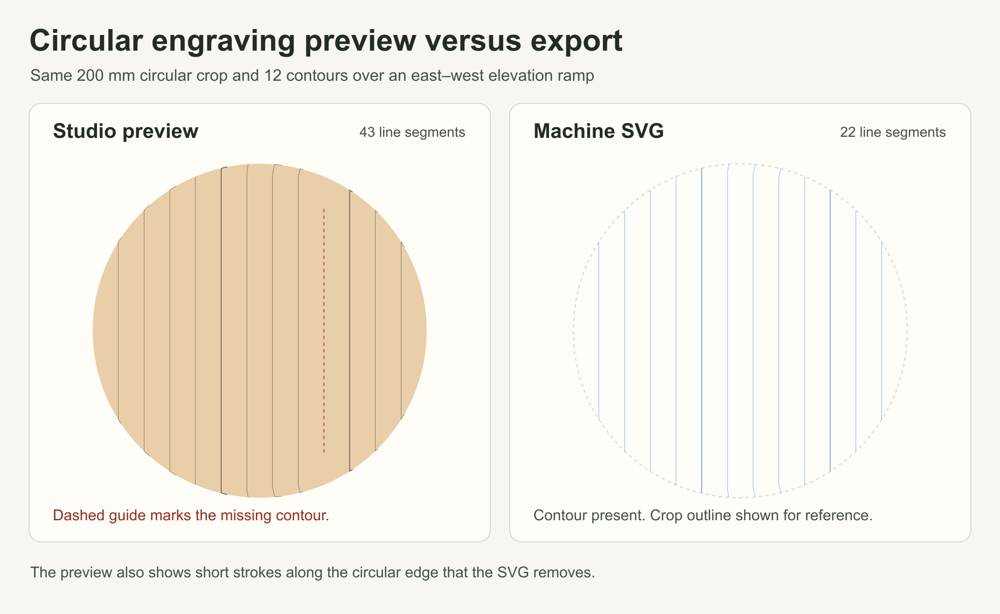

# Export fidelity review

November 22, 2026 · TopoStack 0.13.1 · `dev` at `51b92ad`

The review found 21 defects across source sampling, geometry, fabrication files, project backups and previews. Four warrant fixing first. They can alter a published ocean depth, erase reviewed land, approve intersecting cuts or prevent a sheet layout from finishing. The remaining findings include cases where two routes to the same project settings produce different artwork.

[Corrections and regression coverage](#corrections-and-regression-coverage) records the fixes and subsequent export checks.

## Highest priority

### P1 · Sheet nesting approves overlapping cuts

Two adjacent 10 × 10 mm pieces from the same layer became one rigid cluster. With 0.2 mm kerf and 2 mm requested spacing, their exported cut outlines reached x = 10.1 mm and x = 9.9 mm. The plan verifier returned no issues. Clustering checks proximity and hull area, then the verifier sees only the outside of the cluster. Require the requested clearance between each pair of compensated outlines before grouping them. Test the coordinates in the exported sheet. [Small-part clustering](../../packages/core/src/export/sheet-nest/parts.ts#L117)

### P1 · Terrain cleanup raises a valid Monterey Bay seafloor sample by 204 m

At approximately 36.836767° N, 121.979828° W, the locally provisioned GEBCO tile `9/82/199` contains −314 m at pixel (132, 147). The generator’s spike repair changed it to −110 m. The surrounding 17 × 17 window contained valid GEBCO ocean samples. The repair runs after the preferred terrain has replaced Mapzen samples, so it alters the surface used to generate contours while the source assignment still identifies GEBCO. Apply the Mapzen-specific repair before overlaying preferred terrain, or restrict it to base-source cells. Preserve the archived pixel in a regression test. [Elevation mosaic and repair](../../apps/generator/src/lib/domain/elevation-loader.ts#L46)

### P1 · Final shoreline assembly can erase an explicitly reviewed island

A lake fixture had a 24-vertex HydroLAKES shore, a matching 80-vertex OSM shore, and a reviewed chart island. Chart application produced one island hole. Final shoreline assembly selected the denser OSM outline again and produced zero holes. The carve lowered the island center from 100 m to 75 m. The final water geometry also feeds shore engravings and paint regions. Resolve the base shoreline before applying chart edits, and verify that the island remains dry after final assembly and carving. [Shoreline reselection](../../apps/generator/src/lib/domain/water-assembly.ts#L36)

### P1 · A near-fit part can keep the sheet planner running indefinitely

A 100.01 × 50 mm cut envelope passed the size precheck for a 100 × 100 mm usable sheet. The rectangle packer rejected it, placed zero parts and returned the same remaining part. The baseline loop appends an empty sheet and repeats before reaching the time-budget check. Align the precheck and packing tolerances and terminate any pass that places zero parts. [Size precheck](../../packages/core/src/export/sheet-nest/plan-sheets.ts#L68) · [Packing loop](../../packages/core/src/export/sheet-nest/plan-sheets.ts#L96)

## Geographic data and regeneration

| Priority | Reproduction and impact | Correction |
| --- | --- | --- |
| P2 | **Lake depth exaggeration uses the median bed elevation as the waterline.** With a known 100 m surface, an 80 m median and a 60 m bed, the existing-DEM-basin branch reported an 80 m surface. At 2× exaggeration it produced a 40 m bed. The requested scale about the known surface gives 20 m. | Use the available surface elevation as the reference and test the reported surface and deepest point at both 1× and 2×. [DEM basin carve](../../packages/core/src/water/water.ts#L507) |
| P2 | **Removing a depth chart can retain its island and source credit.** After removal, the normal refresh kept a 100 m dry island, the chart-origin flag, its dataset ID and attribution. A fresh chart-free load put the same point at 70 m. A separate package probe confirmed the obsolete chart ID and credit can reach the manifest. | Rebuild from the lake geometry preceding chart application and replace all chart-specific provenance on refresh. [Refresh invalidation](../../apps/generator/src/lib/studio/source-refresh.ts#L90) · [Provenance assembly](../../apps/generator/src/lib/domain/bathymetry.ts#L297) |
| P2 | **Changing the minimum feature size can leave printable water missing.** With buildings off, a 1 mm square water body was correctly filtered at a 2 mm minimum. Changing the minimum to 0.5 mm left the prepared source with zero water bodies. A fresh vector load for the identical settings returned one. Lake, waterway and boundary loaders also filter at finished size. | Invalidate the affected vector and lake sources whenever a physical-size edit changes those filters. Compare refreshed output with a full regeneration. [Refresh criteria](../../apps/generator/src/lib/studio/source-refresh.ts#L59) · [Vector filtering](../../apps/generator/src/lib/domain/vector-loader.ts#L258) · [Lake filtering](../../apps/generator/src/lib/domain/lake-area-loader.ts#L49) |
| P2 | **A dateline-crossing trail can engrave across Greenwich.** A connected trail from 179.9° E to 179.9° W generated a full-width, 100 mm stroke on a crop spanning −0.05° to +0.05°. Both endpoints were projected independently relative to the crop. | Unwrap consecutive vertices relative to each other, then select the continuous path copies intersecting the crop. Use the same rule for map overlays. [Geometry routing](../../packages/core/src/pipeline/routing.ts#L87) · [Map overlay](../../apps/generator/src/lib/studio/map-overlays.ts#L62) |

## Project backups and material selection

| Priority | Reproduction and impact | Correction |
| --- | --- | --- |
| P2 | **The Complete project ZIP omits traced depth charts.** Its project JSON retains the chart references. Only the standalone Project settings action reads the referenced chart records. Importing the ZIP’s JSON on a fresh device can therefore regenerate the lake using fallback depths. The original fabrication files in the ZIP still contain the generated cuts. | Include the referenced charts in the complete package’s importable JSON. Compare lake geometry after importing into empty storage. [Download branches](../../apps/generator/src/lib/studio/export-notice.ts#L98) · [Package manifest](../../packages/core/src/export/packages.ts#L393) |
| P2 | **The standalone settings download can exceed its own import limit.** A valid chart-free project with 24 graphics of 3,000 points each serialized to 2,793,201 bytes. The importer rejects chart-free files over 2,000,000 bytes. | Compact large coordinate arrays and check the final file against the import contract before declaring it ready. Test the largest supported combination of artwork and paths. [Settings writer](../../apps/generator/src/lib/studio/native-export.ts#L67) · [Settings reader](../../apps/generator/src/lib/studio/project-file.ts#L18) |
| P2 | **The seventeenth referenced depth chart silently drops out of a backup.** A valid settings file below 2 MB retained 17 lake references. After export and import into empty storage only 16 charts were restored. Both writer and reader slice the list. | Apply a consistent project-wide limit when charts are attached, or serialize every referenced chart within the file-size budget. Flag any incomplete backup at export. [Chart export and import](../../apps/generator/src/lib/storage/user-charts.ts#L197) |
| P2 | **A project name can change which material files download.** For `Lake Acrylic`, the wood panel selector rejects `lake-acrylic-layer-01.svg`. The acrylic selector accepts the wood master and the nested wood sheet because their names also end in `-acrylic-master.svg` and `-acrylic-sheet-01.svg`. | Select by the file’s material and role, or remove the exact project-name prefix before interpreting the generated suffix. [Download selection](../../apps/generator/src/lib/studio/native-export.ts#L86) |

## Fabrication geometry and file editing

| Priority | Reproduction and impact | Correction |
| --- | --- | --- |
| P2 | **Free rotation rejects a strip that fits diagonally.** A 120 × 5 mm rectangular strip was rejected for a clear 100 × 100 mm sheet. Its 45° envelope measures 88.388 × 88.388 mm. The precheck tried only quarter turns for this outline. | Include sheet-constrained angles in the feasibility test and baseline packer before rejecting the part as oversize. [Orientation precheck](../../packages/core/src/export/sheet-nest/plan-sheets.ts#L68) |
| P2 | **A filled engraving can cross an opening and be exported on both materials.** A 16 × 16 mm filled marker enclosing a 4 × 4 mm acrylic opening survived intact on the wood, while the acrylic received the 4 × 4 mm center as well. Testing only the marker vertices misses an enclosed hole. | Apply polygon difference or intersection when bounds overlap. Account for enclosed holes and edge crossings in the equivalent glyph shortcut. [Fill clipping](../../packages/core/src/pipeline/marking-clip.ts#L42) · [Glyph clipping](../../packages/core/src/pipeline/marking-clip.ts#L65) |
| P2 | **LightBurn panel files lose movable piece groups.** A normal one-piece layer SVG became 165 independent paths and zero groups in its `.lbrn2` export. Moving the cut outline in LightBurn can leave its holes and engraving behind. The converter only groups transformed SVG groups. | Preserve groups carrying piece identity, including those with an identity transform. Compare piece membership in the panel SVG and LightBurn XML. [LightBurn group handling](../../packages/core/src/export/lightburn.ts#L220) |
| P3 | **Combined master SVGs reuse element IDs.** A split fixture produced 48 duplicate IDs. The Shinjuku Station master also repeated `layer-04-ENGRAVE-major-roads` 16 times. Editors or scripts selecting by ID can address the wrong piece. | Include the piece or panel ID in each group identifier and check document-wide uniqueness after composing a master. [Marking group IDs](../../packages/core/src/export/svg-primitives.ts#L155) |
| P3 | **The assembly guide prints a zero work-area dimension.** A 180 mm width with unrestricted height produced “180 mm × 0 mm work area” in the materials list. | Print the constrained axis alone when the other is unrestricted. Check width-only and height-only projects. [Guide materials list](../../packages/core/src/export/assembly-guide.ts#L345) |

## Preview and presentation

| Priority | Reproduction and impact | Correction |
| --- | --- | --- |
| P2 | **Circular engraving previews omit a real contour and add edge strokes.** On the 200 mm circular crop above, 12 requested contours over an 11 × 11 east–west elevation ramp yielded 43 drawn line segments in Studio and 22 in the SVG. Studio omitted the ninth contour and retained short strokes at the crop edge. Its component also supplies the flat share image. | Share one implementation for opening contour rings at the crop edge. Assert matching visible paths in a preview and its exported SVG. [Studio contour paths](../../apps/generator/src/lib/studio/EngravingPreview.svelte#L29) · [SVG contour paths](../../packages/core/src/export/engraving-svg.ts#L10) |
| P2 | **Marker clearances erase fills in the preview that survive in the machine file.** With two 10 mm circle markers centered 6 mm apart, x = 1.8 mm was inside the first fill and the second halo but outside the second fill. The preview showed bare wood there. The SVG still engraves it. At x = 3 mm both exported fills overlap. | Apply each knockout to underlying geometry in drawing order, including filled symbols and glyphs, while preserving its own symbol. [SVG marking clearance](../../packages/core/src/export/svg-primitives.ts#L134) |
| P2 | **Acrylic insert previews can hide a marker and the gap around it.** On an eight-layer lake model the acrylic SVG included a filled marker and interrupted a causeway between x = −4.317 mm and +4.317 mm. The 3D preview omitted the marker and showed a continuous causeway. The cut view showed the marker but also drew the uncleared causeway. | Render the insert from the same filled geometry and cleared lines that the fabrication writer uses. [3D insert preview](../../apps/generator/src/lib/studio/ThreePreview.svelte#L499) · [Cut preview](../../apps/generator/src/lib/studio/TwoDPreview.svelte#L76) |
| P2 | **The saved preview image omits raised airspace plates.** Adding a visible 40 × 40 mm blue plate above an otherwise identical stack produced byte-identical SVG artwork for the share image. The airspace files and physical model include the plate. | Composite airspace pieces at their level heights and tints in the top-down artwork used by the PNG exporter. [Share renderer](../../apps/generator/src/lib/studio/ShareArtwork.svelte#L8) · [Top-down artwork](../../apps/generator/src/lib/studio/placement/StackTopView.svelte#L26) |

## Verification and limits

- The data contracts, chart tracing, nesting, core geometry, generator, Worker and script suites passed. The Node workspaces and scripts account for 2,702 tests. The Python data builders passed 134 tests with the repository’s pinned geospatial dependencies.
- Seven Chromium end-to-end tests passed. They cover the complete fabrication ZIP, stock-sheet downloads, airspace files and guide, custom graphics, annotation placement, reviewed chart islands before generation, and the Atomm automatic nesting bridge. The browser runs use the repository’s deterministic terrain fixtures.
- The Monterey Bay comparison used an actual locally provisioned GEBCO archive. Other measured deltas used controlled geometry or project fixtures through the relevant loading, carving, rendering and export functions. The circular comparison uses the actual path data from both renderers. The dashed guide and reference outline were added for comparison.
- A browser rendering of the previously exported five-layer Shinjuku Station assembly guide showed readable dimensions and layer counts on the cover. All five sections fit the checked desktop width. Machine-file checks inspected SVG, LightBurn XML and ZIP contents. Native LightBurn/xTool application imports, physical cutting, and a survey of every live data region remain unverified.

## Corrections and regression coverage

The findings above describe the reviewed commit. The following checks exercise the corrected generation, download and import paths.

| Review cases | Verified result |
| --- | --- |
| Monterey sounding, island preservation, chart removal and lake depth scale | The archived GEBCO sample remains −314 m. The reviewed island stays at 100 m with a 75 m bed beside it. Removing the chart restores the 70 m bed and clears its source credits. A 60 m bed exaggerated 2× about a 100 m waterline reaches 20 m. [Terrain samples](../../apps/generator/src/lib/domain/terrain-sources.test.ts) · [Chart lifecycle](../../apps/generator/src/lib/domain/user-bathymetry.test.ts) · [Depth scaling](../../packages/core/src/water/bathymetry.test.ts) |
| Clustered cut spacing, oversize termination and diagonal fit | The coordinates in the exported sheets meet the requested 2 mm and 5 mm gaps. A 100.01 mm envelope raises an oversize error on a 100 mm sheet. Free rotation fits a 120 × 5 mm strip diagonally. [Exported cut coordinates](../../packages/core/src/export/sheet-nest/nested-package.test.ts) · [Sheet planner](../../packages/core/src/export/sheet-nest/plan-sheets.test.ts) |
| Minimum feature edits and dateline-crossing paths | Lowering the minimum restores the same 1 mm water body as a fresh load. The connected trail appears at the dateline and leaves the Greenwich crop clear. [Source refresh](../../apps/generator/src/lib/studio/source-refresh.test.ts) · [Generated paths](../../packages/core/src/pipeline/generate.test.ts) · [Map overlays](../../apps/generator/src/lib/studio/map-overlays.test.ts) |
| Complete backups, large settings, seventeenth chart and material filenames | Both ZIP formats restore all 17 chart records into empty storage, including the sampled lake’s carved grid. A project with 24 graphics of 3,000 points each survives a round trip. A project named “Lake Acrylic” produces distinct wood and acrylic bundles. [ZIP round trips](../../apps/generator/src/lib/storage/user-charts.test.ts) · [Settings sizes](../../apps/generator/src/lib/studio/project-file.test.ts) · [Download selections](../../apps/generator/src/lib/studio/native-export.test.ts) |
| Enclosed holes, marker clearances, acrylic inserts and circular contours | A 256 mm² fill is divided into 240 mm² on wood and 16 mm² on acrylic. The eight-layer causeway stops at ±4.317 mm around the marker. The circular SVG and preview have identical paths, including the ninth contour and all 22 segments. [Water insert SVGs](../../packages/core/src/export/water-inserts.test.ts) · [Marker draw order](../../packages/core/src/export/svg-clearance.test.ts) · [Mounted previews](../../apps/generator/src/lib/studio/previews.client.test.ts) |
| LightBurn piece groups, master SVG identifiers and one-axis work areas | Panel files retain each piece’s cuts and engraving in its LightBurn group. The split master has unique element IDs, including paths crossing panel seams. Width-only and height-only assembly guides name the constrained dimension. [LightBurn XML](../../packages/core/src/export/lightburn.test.ts) · [SVG masters](../../packages/core/src/export/svg.test.ts) · [Assembly guides](../../packages/core/src/export/assembly-guide.test.ts) |
| Saved airspace preview | The top-down image paints the acrylic faces at their assembled heights and preserves their holes and engravings. The browser regression decodes the downloaded PNGs and compares artwork pixels before and after adding the plates. [Face order](../../apps/generator/src/lib/studio/share-artwork.client.test.ts) · [PNG download](../../e2e/airspace.spec.ts) |

The integrated changes passed 2,741 workspace and script tests, 134 Python data-builder tests, typechecking, linting, the production build and both bundle budgets. Twelve distinct browser checks passed. Chromium exercised eight export and editing workflows. Firefox and WebKit also downloaded the complete ZIP and compared the share PNG with and without airspace.

A separate 150 × 150 mm Monterey Canyon engraving used a 64 × 64 crop of the locally provisioned GEBCO archive. All 4,096 sampled elevations matched the archived pixels. The grid ranged from −1,114 m to −31 m and produced 16 contour elevations in 25 SVG paths. The ZIP contained the same SVG bytes and the GEBCO attribution. Browser airspace tests used deterministic fixtures. LightBurn verification inspected the XML structure. Native machine-software imports and physical cuts remain unverified.
